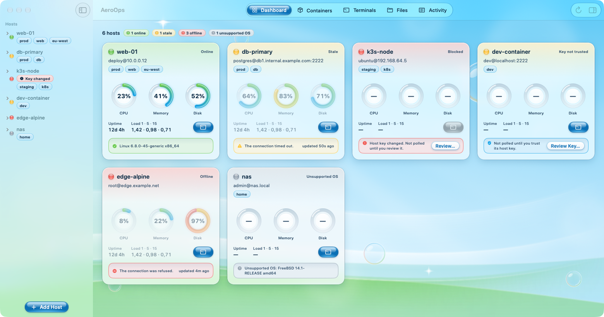
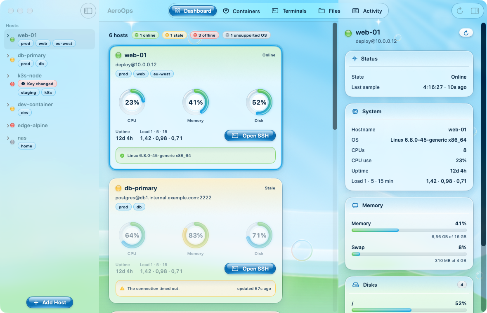
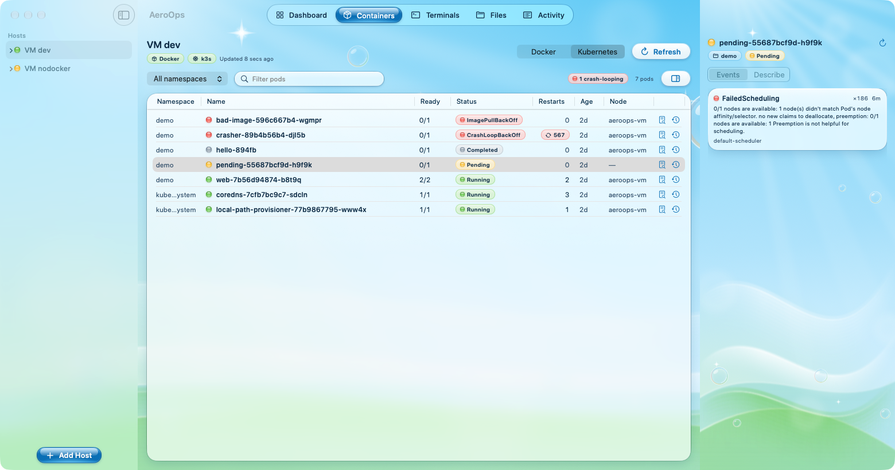
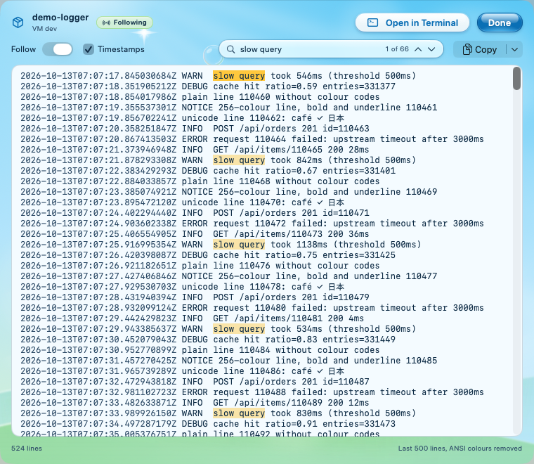
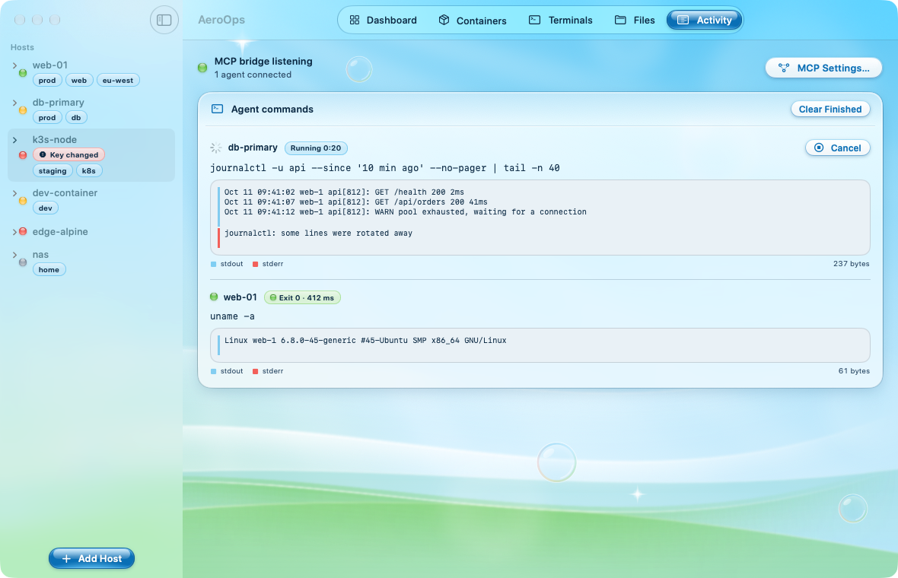
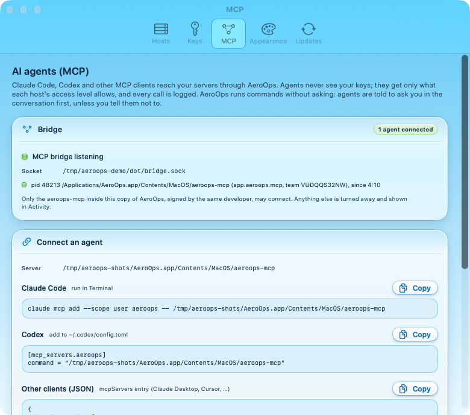
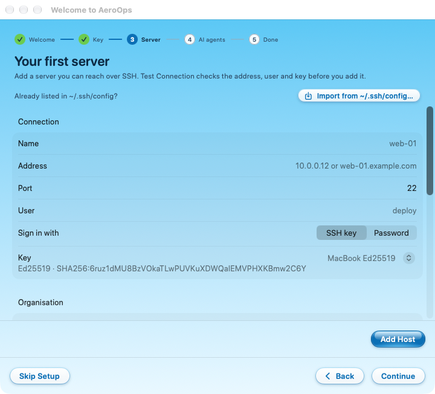
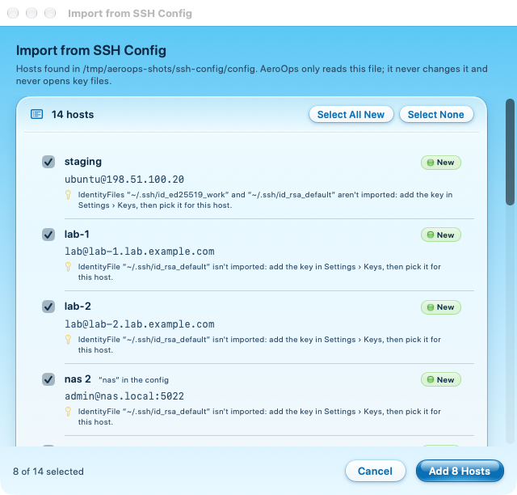
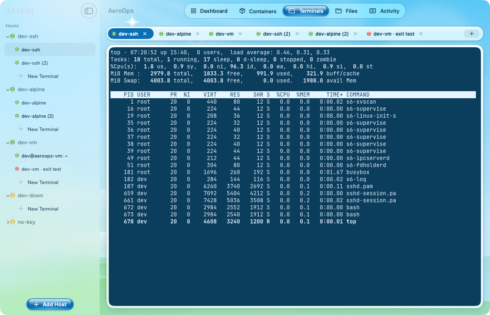

# AeroOps

AeroOps is a native macOS app for keeping an eye on a handful of Linux servers over SSH. Each server gets a live card with CPU, memory, disk, uptime and load. You can browse its Docker containers and Kubernetes pods, read their logs, and open terminal tabs to it. A local MCP server, `aeroops-mcp`, lets AI agents such as Claude Code and Codex use the same servers. Agents never see your keys, and they are told to ask you before running any command. The only thing a server needs is SSH: nothing is installed on it. Private keys stay in the macOS Keychain or the Secure Enclave.



| | |
| --- | --- |
|  |  |
| Host detail | Kubernetes pods, with Events for a pending pod |
|  |  |
| Container logs with search | Agent commands with live output in Activity |
|  |  |
| Settings › MCP | First-run onboarding |
|  |  |
| Import from `~/.ssh/config` | Terminal tabs, with `top` on a dev server |

The screenshots show the app's built-in demo data and the dev VM described below.

## Features

- **Monitoring cards.** Each host has a card with CPU, memory and disk gauges, uptime and load average. Cards show when a host is online, stale, offline, blocked by a changed host key, waiting for a host key to be trusted, or running an unsupported OS. Every card is the same size in every state, so the grid stays even. Hosts are polled every 5 s while the window is on screen and every 30 s otherwise. Polling stops while the Mac sleeps and backs off when a host is unreachable. Each poll is a single POSIX `sh` script (`Scripts/remote/metrics.sh`) sent over the host's SSH ControlMaster connection. It also runs on BusyBox. The host detail view lists every mount, plus memory and swap.
- **Docker.** A container list that merges `docker ps` and `docker stats`, with Running/All filters and a text filter. When the SSH user can't reach the Docker socket, the app shows a hint and offers a per-host "Run docker with sudo -n" option.
- **Kubernetes.** A pod list with ready count, restarts, CPU and memory (when the cluster runs metrics-server), age and node, plus a namespace filter. Crash-looping pods are flagged. Describe and Events open in a side panel. kubectl runs through a per-host prefix, for example `sudo -n k3s kubectl`.
- **Logs.** The viewer loads the last 500 lines. It can follow new output, search, copy and strip ANSI colours. For pods it has a container picker and shows previous logs of a crashed container. "Open in Terminal" runs `docker logs -f` in a terminal tab.
- **Terminal tabs.** The terminal is [libghostty](https://github.com/Lakr233/libghostty-spm). "Open SSH" on a card or in the sidebar opens a tab running `/usr/bin/ssh` against that host. It signs in through the in-app agent.
- **Keys.** Generate Secure Enclave P-256 or Ed25519 keys, or import unencrypted OpenSSH keys. You can copy the `authorized_keys` line for each key.
- **MCP tools for AI agents.** Each host has an access tier: **Off**, **Read** (the default) or **Read + Exec**.
  - Read tools: `list_hosts`, `get_host_metrics`, `list_containers`, `list_pods` and `get_logs`.
  - Exec tool: `run_command`.
- **Asking before commands.** AeroOps runs `run_command` on a Read + Exec host as soon as the agent calls it. The MCP server's instructions and the tool's description tell the agent to show you the host, the exact command and its reason, and to wait for your yes in the conversation first. The agent skips asking only if you have told it not to ask. This is an instruction to the agent, not something AeroOps enforces. Keep hosts at Read when that matters.
- **Activity.** The Activity tab shows running and recent agent commands with their live output, and you can cancel a running command there.
- **Import from `~/.ssh/config`.** The importer follows `Include`, `Host` patterns and `Match all` the way OpenSSH does. It imports each host's name, address, port and user. It only reads the config: key files are never opened and nothing under `~/.ssh` is written. Hosts that use `ProxyJump` or `ProxyCommand` are listed with the reason they can't be imported.
- **Onboarding.** On first run, a sheet walks through five steps: Welcome, Key, Server, AI agents and Done. It covers creating or importing a key, adding or importing a first server, and connecting an agent. Existing users never see it.

## Requirements

- macOS 26 or later
- Xcode 26 or later with Swift 6.2. The app builds in Swift 6 language mode with strict concurrency.
- [XcodeGen](https://github.com/yonaskolb/XcodeGen): `brew install xcodegen`
- For the dev servers: Docker or [OrbStack](https://orbstack.dev). The Kubernetes VM needs OrbStack.

Xcode resolves the Swift packages. Most are pinned to exact versions:

| Package | Version |
| --- | --- |
| [libghostty-spm](https://github.com/Lakr233/libghostty-spm) | 2.2.2026101003 |
| [MCP Swift SDK](https://github.com/modelcontextprotocol/swift-sdk) | 0.12.1 |
| [Sparkle](https://github.com/sparkle-project/Sparkle) | 2.10.0 |
| [swift-log](https://github.com/apple/swift-log) | 1.5.0 or later |

## Build and test

The Xcode project is generated from `project.yml`. `AeroOps.xcodeproj` is git-ignored: edit `project.yml`, never the project.

```sh
xcodegen generate
xcodebuild -scheme AeroOps -destination 'platform=macOS' build
swift test --package-path Packages/AeroKit
```

`xcodebuild -scheme AeroOps -destination 'platform=macOS' test` runs the same package tests through Xcode.

Integration tests talk to the dev servers and are skipped unless `AEROOPS_INTEGRATION=1` is set:

```sh
AEROOPS_INTEGRATION=1 swift test --package-path Packages/AeroKit --filter SSHKitTests
```

The app uses the hardened runtime. It runs without the App Sandbox, because it starts `/usr/bin/ssh`, owns PTYs and listens on Unix sockets in `~/.aeroops/`, and the sandbox blocks all three.

## Dev environment

There are three local test servers. All of them are key-only SSH.

| Server | Address | User | Built from |
| --- | --- | --- | --- |
| `aeroops-ssh` | `localhost:2222` | `dev` | `dev/compose.yml` |
| `aeroops-alpine` | `localhost:2223` | `dev` | `dev/compose.yml` (BusyBox userland) |
| `aeroops-vm` | `aeroops-vm.orb.local:22` | `dev`, `nodocker` | `dev/vm/setup.sh` (OrbStack Ubuntu 24.04 with Docker and k3s) |

```sh
docker compose -f dev/compose.yml up -d    # start both containers
dev/vm/setup.sh                            # create or update the VM and its demo workloads
dev/add-key.sh <path-to.pub>               # authorize a public key on every running server
dev/remove-key.sh <path-to.pub>            # and remove it again
```

The VM runs demo workloads in every state the Containers tab has to render:

- Docker: a web server, a noisy logger and an exited container.
- k3s: a healthy deployment, a crash-looping pod, a pending pod, a bad image and a completed Job.

The `nodocker` user cannot reach the Docker socket, which exercises the permission hint.

### Demo data

DEBUG builds accept launch arguments that point the app at a throwaway data directory and fill it with sample hosts. These are the arguments used for the screenshots:

```sh
AeroOps.app/Contents/MacOS/AeroOps -AeroOpsDataDirectory /tmp/aeroops-demo \
  -AeroOpsDemoHosts YES -AeroOpsDemoStatuses YES -AeroOpsDemoKeys YES
```

Add `-AeroOpsSnapshotDirectory <dir>` to write PNGs of every tab and quit. The full list, including the per-phase self-tests, is in `App/Support/DebugSupport.swift`.

## Connecting an AI agent (MCP)

`aeroops-mcp` is a stdio MCP server inside the app bundle at `AeroOps.app/Contents/MacOS/aeroops-mcp`. It forwards each tool call to the running app over `~/.aeroops/bridge.sock`. If the app isn't running, `aeroops-mcp` starts it in the background and retries for 10 seconds.

Settings › MCP shows the exact path of the running copy and has a Copy button for each client. With the app in `/Applications`, the snippets are:

Claude Code (run in Terminal):

```sh
claude mcp add --scope user aeroops -- /Applications/AeroOps.app/Contents/MacOS/aeroops-mcp
```

Codex (add to `~/.codex/config.toml`):

```toml
[mcp_servers.aeroops]
command = "/Applications/AeroOps.app/Contents/MacOS/aeroops-mcp"
```

Other clients that take an `mcpServers` entry (Claude Desktop, Cursor, …):

```json
{
  "mcpServers" : {
    "aeroops" : {
      "command" : "/Applications/AeroOps.app/Contents/MacOS/aeroops-mcp"
    }
  }
}
```

T3 Code runs Claude Code or Codex underneath and uses their MCP settings. AeroOps never edits an agent's config files. If you move AeroOps.app, copy the snippet again.

Set each host's tier in Settings › MCP or in the host editor. New hosts start at Read.

## Security model

- **Keys stay in the Keychain or the Secure Enclave.**
  - Secure Enclave keys can't be exported.
  - No private key file is written. After an import, the app offers to move the original key file to the Trash.
  - RSA signs with SHA-2 only.
- **The in-app ssh-agent** listens on `~/.aeroops/agent.sock`. The socket is mode `0600` inside a `0700` directory.
  - It answers only identity and sign requests. Requests to add, remove or lock keys are refused.
  - Any client other than `/usr/bin/ssh` started by AeroOps needs Touch ID.
  - Each key has its own Touch ID policy: never, once per app session, or for every signature.
  - "Use system ssh-agent instead" switches to your own agent.
- **One SSH path.** All remote access uses the system `/usr/bin/ssh` with a generated `~/.aeroops/ssh_config`, `BatchMode` and one ControlMaster per host.
  - Every value put into a remote command is shell-quoted.
  - The collection scripts in `Scripts/remote/` are POSIX `sh` and run with `LC_ALL=C`.
- **Host keys are trust on first use.**
  - On first contact, `ssh-keyscan` fetches the key and you confirm its SHA256 fingerprint.
  - After that, `StrictHostKeyChecking yes` is enforced. A changed key blocks the host and shows a red banner.
- **Agents never get SSH.**
  - `aeroops-mcp` has no access to the agent socket or the keys.
  - The bridge accepts only an `aeroops-mcp` whose code signature carries AeroOps's team ID and identifier.
  - Every call goes through the policy engine. Off and Read hosts reject `run_command`. Read + Exec hosts run it without a prompt in AeroOps; the agent is told to ask you first.
- **Remote output is untrusted.** Logs and command output are labelled as untrusted remote content for the agent.
  - Output is capped at 64 KB per stream and 2,000 log lines.
  - `run_command` times out after at most 300 seconds.
  - A cancelled or timed-out command has its remote process group killed.

## Project layout

```text
App/                    SwiftUI app: Dashboard, Containers, Terminals, Activity, Settings,
                        Onboarding, Shell, Services, Model, Components, Support
MCP/                    aeroops-mcp, the stdio MCP server that forwards to the app
Packages/AeroKit/       Swift package with one target per module:
  Sources/AeroCore        models, parsers, ShellQuote, HostStore, ssh config importer
  Sources/SSHKit          system ssh, generated ssh_config, ControlMaster, host-key trust
  Sources/KeyAgent        in-app ssh-agent, Keychain and Secure Enclave key store
  Sources/Collectors      metrics, Docker and Kubernetes collectors, polling actors
  Sources/TerminalKit     libghostty wrapper
  Sources/BridgeProtocol  bridge.sock messages and client, shared with aeroops-mcp
  Sources/AgentBridge     bridge server, PolicyEngine, run_command
  Sources/AeroTheme       theme tokens and shared views (AeroCard, GlossyGauge, StatusOrb, ...)
  Tests/                  one test target per module, plus BridgeHarness and test helpers
Scripts/remote/         POSIX sh scripts run on servers (metrics.sh, probe.sh, run-command.sh)
Scripts/release.sh      signed, notarized release build
dev/                    dev servers, VM, fixtures and self-test helpers
docs/                   plan, decisions, release guide, screenshots
spikes/                 Phase 0 throwaway spikes
project.yml             XcodeGen spec
```

## Status

Phases 0 to 8 are done: spikes, the host inventory, keys and transport, the dashboard, terminal tabs, Docker, Kubernetes, the MCP read tier, and the exec tier. In Phase 9, ssh-config import and onboarding are done.

Still open:

- **Release signing.**
  - Done: the hardened runtime, Sparkle wiring and `Scripts/release.sh`.
  - Left: the Developer ID certificate, notarization credentials and the Sparkle signing key.A build with no feed URL and key never starts Sparkle, and Settings › Updates says so.
- **Performance pass (in progress).** The target is that 20 polled hosts keep the app under 3% CPU.
- **T3 Code check.** The copy-config buttons are done, but nobody has yet confirmed by hand that the tools work from T3 Code.

The backlog after v1 includes a hub for history and alerts, tmux-backed tabs, password auth and Podman.

## Docs

